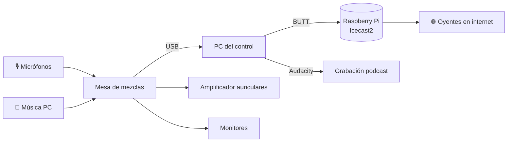
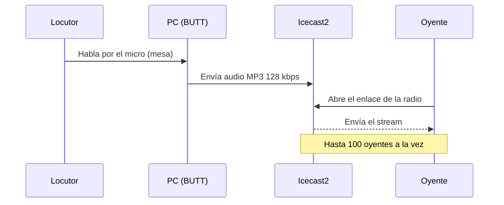
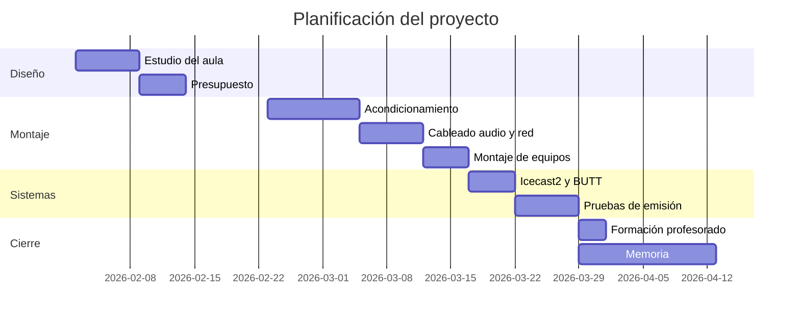
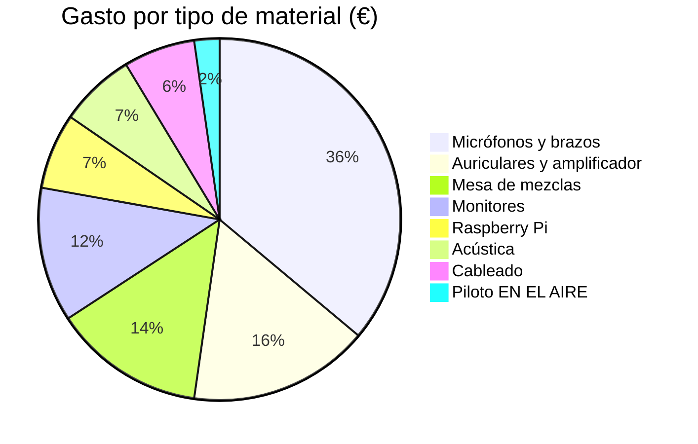
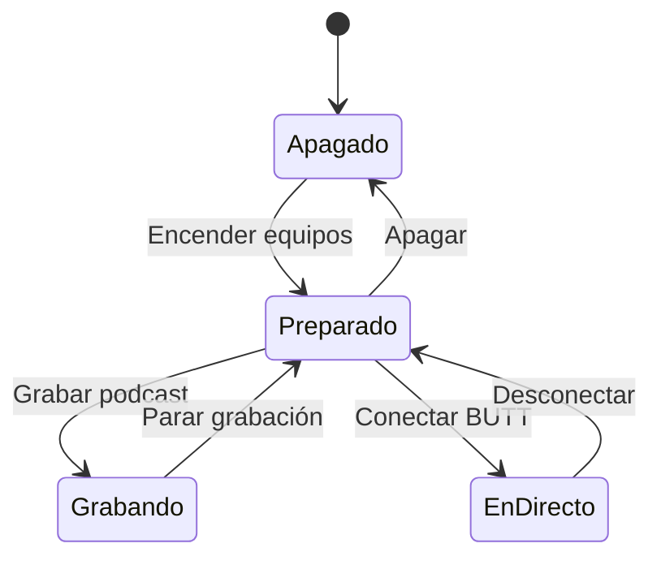

<!-- AE01.11 Markdown. Proyecto - David Uhagón Vega - 1º IABD -->
<!-- Tema elegido: mi trabajo de fin de ciclo de Telecomunicaciones (radio escolar) -->

<div align="center">


<h1>📻 Montaje de una radio escolar desde cero</h1>

<p><b>Trabajo de fin de ciclo · CFGS Sistemas de Telecomunicaciones e Informáticos</b><br>
Alumno: David Uhagón Vega</p>


</div>

---

# Índice

1. [Introducción](#introducción)
2. [Objetivos](#objetivos)
3. [Material utilizado](#material-utilizado)
4. [Instalación del estudio](#instalación-del-estudio)
5. [Configuración del streaming](#configuración-del-streaming)
6. [Cálculos del proyecto](#cálculos-del-proyecto)
7. [Planificación](#planificación)
8. [Resultado final](#resultado-final)
9. [Bibliografía y enlaces](#bibliografía-y-enlaces)

---

# Introducción

[⬆️ Volver al índice](#índice "Ir al índice")

En mi colegio ya se hacían algunos programas de radio, pero se grababan en una clase con un portátil y un micrófono USB, y el sonido se escuchaba bastante mal.  
Por eso, para el **trabajo de fin de ciclo** decidí montar un *estudio de radio completo* desde cero: desde elegir el sitio y el material hasta dejarlo emitiendo por internet.

El proyecto tiene una parte de **instalación** (cableado, acondicionamiento y montaje de equipos) y otra parte de **sistemas** (servidor de streaming, scripts y copias de seguridad).<br>
Todo se hizo con un presupuesto limitado, así que hubo que buscar material que fuera ***bueno, bonito y barato***.

Al principio la idea era emitir en FM, pero eso ~~se podía hacer sin problema~~ necesita una licencia que un colegio no puede pedir, así que al final la emisión es solo por internet y en formato podcast.

> [!NOTE]
> Este documento es un resumen de la memoria del proyecto adaptado a Markdown para la actividad AE01.11 del módulo de Programación de IA.

## Situación de partida

- El aula elegida era un antiguo **almacén** de unos 15 m².
- No tenía tomas de red cerca ni aislamiento.
- Había muchos ruidos del patio en el recreo.

## ¿Por qué una radio escolar?

> "La radio debe transformarse de aparato de distribución en aparato de comunicación."
>
> — **Bertolt Brecht**, *Teoría de la radio* (1932)

Esta idea de Brecht resume lo que buscaba: que el alumnado no solo escuche, sino que **participe** y cree sus propios contenidos.

---

# Objetivos

[⬆️ Volver al índice](#índice "Ir al índice")

## Objetivo general

Diseñar, instalar y poner en marcha un estudio de radio en el colegio que permita grabar podcasts y emitir en directo por internet.

## Objetivos específicos

1. Diseñar la distribución del estudio
   1. Separar locutorio y control
   2. Hacer el plano con las medidas
2. Elegir y montar el equipamiento
   - Mesa de mezclas
   - Micrófonos y auriculares
   - Monitores de estudio
3. Configurar el servidor de streaming
   - Instalar **Icecast2** en una Raspberry Pi
   - Conectar el emisor (*BUTT*) con el servidor
4. Formar al profesorado y al alumnado en el uso del estudio

### Lista de tareas del proyecto

- [x] Estudio del aula y medidas
- [x] Presupuesto y pedido de material
- [x] Acondicionamiento acústico
- [x] Cableado de audio y de red
- [x] Instalación de Icecast2 en la Raspberry
- [x] Pruebas de emisión
- [x] Formación al profesorado
- [ ] Automatizar la subida de los programas a Spotify
- [ ] Añadir una segunda cabina para entrevistas

---

# Material utilizado

[⬆️ Volver al índice](#índice "Ir al índice")

El presupuesto completo está en el archivo [docs/presupuesto.md](docs/presupuesto.md "Ver presupuesto detallado").

## Equipos de audio

| Equipo | Modelo / tipo | Uso |
|:---|:---|:---|
| Mesa de mezclas | USB, 8 canales | Mezclar micros y música y enviar al PC |
| Micrófonos | Dinámicos de locución (x4) | Locutores e invitados |
| Auriculares | Cerrados (x5) | Escucha de los locutores y el técnico |
| Amplificador de auriculares | 4 salidas | Repartir la señal a los auriculares |
| Monitores | Pareja de 5" | Escucha en el control |

## Equipos informáticos y red

| Equipo | Cantidad | Conexión | Función |
|:---:|:---:|:---:|:---:|
| PC del control | 1 | Ethernet | Emisión con BUTT y grabación con Audacity |
| Raspberry Pi 4 | 1 | Ethernet | Servidor Icecast2 |
| Switch | 1 | - | Red del estudio |
| SAI | 1 | - | Protección ante cortes de luz |

<details>
<summary>📦 <b>Ver por qué elegí micrófonos dinámicos y no de condensador</b></summary>
<br>

Los micrófonos de condensador captan mucho más el ambiente de la sala. Como el aula no tiene un aislamiento profesional, con los dinámicos se cuela mucho menos ruido del patio. Además, no necesitan alimentación *phantom* de 48 V.

</details>

---

# Instalación del estudio

[⬆️ Volver al índice](#índice "Ir al índice")

## Distribución

El estudio se dividió en dos zonas separadas por un cristal: el **locutorio** y el **control**.

")

## Cadena de audio

Así va la señal desde el micrófono hasta los oyentes:



## Cableado

- Para los micrófonos se usó cable **XLR balanceado**.
  - Conector macho en el micro y hembra en la mesa.
  - Longitud máxima de 5 m.
- Para los monitores, cable *jack TRS* de 6,3 mm.
- La red se hizo con cable **UTP Cat6** desde el rack del pasillo.
  - Se instaló una roseta doble en el control.
  - Se certificó el enlace con el comprobador del instituto.

> [!WARNING]
> Nunca hay que conectar o desconectar los micrófonos con el canal de la mesa abierto y la alimentación *phantom* activada, porque se puede dañar el equipo y los monitores dan un golpe muy fuerte.

## Acondicionamiento acústico

Se pusieron paneles de espuma en las paredes del locutorio y una alfombra para quitar reverberación. Para medir la reverberación usé la fórmula de Sabine (está en el apartado de [cálculos](#cálculos-del-proyecto "Ir a los cálculos")).

---

# Configuración del streaming

[⬆️ Volver al índice](#índice "Ir al índice")

El servidor de streaming es **Icecast2** instalado en una Raspberry Pi con Raspberry Pi OS. Para emitir desde el PC se usa el programa `BUTT` (*Broadcast Using This Tool*), que manda el audio de la mesa al servidor.

## Instalación de Icecast2

Desde la terminal de la Raspberry:

```bash
sudo apt update
sudo apt install icecast2
# durante la instalación pregunta las contraseñas
sudo systemctl enable icecast2
sudo systemctl start icecast2
systemctl status icecast2
```

## Configuración del servidor

Estas son las partes del fichero `/etc/icecast2/icecast.xml` que cambié:

```xml
<limits>
    <clients>100</clients>
    <sources>2</sources>
</limits>

<authentication>
    <source-password>********</source-password>
    <admin-user>admin</admin-user>
    <admin-password>********</admin-password>
</authentication>

<listen-socket>
    <port>8000</port>
</listen-socket>
```

> [!IMPORTANT]
> Las contraseñas por defecto de Icecast son `hackme`. Hay que cambiarlas siempre antes de abrir el puerto al exterior.

## Configuración de BUTT

| Parámetro | Valor |
|:---|---:|
| Servidor | IP de la Raspberry |
| Puerto | 8000 |
| Punto de montaje | `/radio` |
| Códec | MP3 |
| Bitrate | 128 kbps |
| Frecuencia de muestreo | 44 100 Hz |

## Script de comprobación

Hice un pequeño script en Python que mira cada 5 minutos si la radio está emitiendo y lo guarda en un log. El script completo está en [scripts/comprobar_stream.py](scripts/comprobar_stream.py "Ver el script").

```python
fuentes = datos["icestats"].get("source", [])
if isinstance(fuentes, dict):
    fuentes = [fuentes]

for fuente in fuentes:
    if fuente.get("listenurl", "").endswith(PUNTO_MONTAJE):
        escribir_log("OK: emitiendo")
```

Para que se ejecute solo se añade esta línea con `crontab -e`:

```bash
*/5 * * * * python3 /home/pi/scripts/comprobar_stream.py
```

## Funcionamiento de una emisión en directo



> [!TIP]
> Para probar el stream sin altavoces se puede abrir `http://IP_RASPBERRY:8000/radio` en el móvil conectado a la misma red. Para parar BUTT rápido se pulsa <kbd>Ctrl</kbd> + <kbd>Q</kbd>.

---

# Cálculos del proyecto

[⬆️ Volver al índice](#índice "Ir al índice")

## Ancho de banda del stream

El ancho de banda que necesita el servidor depende del bitrate $b$ y del número de oyentes $N$:

$$
BW = N \cdot b = 100 \cdot 128\ \text{kbps} = 12\ 800\ \text{kbps} \approx 12{,}8\ \text{Mbps}
$$

Como la fibra del colegio tiene 300 Mbps de subida, no hay problema.

## Muestreo del audio

Según el teorema de Nyquist, la frecuencia de muestreo tiene que ser al menos el doble de la frecuencia máxima: $f_s \geq 2 \cdot f_{max}$. Con $f_{max} = 20\ \text{kHz}$ (límite del oído) sale que $f_s \geq 40\ \text{kHz}$, por eso se usa $44{,}1\ \text{kHz}$.

## Espacio de las grabaciones

Las grabaciones se guardan en WAV (sin comprimir) y luego se pasan a MP3. Un programa de 30 minutos en WAV ocupa:

$$
T = f_s \cdot n \cdot c \cdot t = 44\ 100 \cdot 16 \cdot 2 \cdot 1800 \approx 2{,}54 \cdot 10^{9}\ \text{bits} \approx 318\ \text{MB}
$$

En MP3 a 128 kbps el mismo programa ocupa $128\ 000 \cdot 1800 / 8 \approx 28{,}8\ \text{MB}$.

## Niveles de audio

Para ajustar la ganancia de los micrófonos en la mesa se trabaja en decibelios:

$$
G_{dB} = 20 \cdot \log_{10}\left(\frac{V_{salida}}{V_{entrada}}\right)
$$

## Reverberación del locutorio

Con la fórmula de Sabine se calcula el tiempo de reverberación $T_{60}$ a partir del volumen $V$ de la sala y la absorción $A$:

$$
T_{60} = 0{,}161 \cdot \frac{V}{A}
$$

Antes de poner los paneles salía alrededor de $0{,}9\ \text{s}$ y después bajó a unos $0{,}4\ \text{s}$, que está bien para voz.

---

# Planificación

[⬆️ Volver al índice](#índice "Ir al índice")

## Diagrama de Gantt



## Reparto del presupuesto



## Estados del estudio



---

# Resultado final

[⬆️ Volver al índice](#índice "Ir al índice")

El estudio quedó funcionando y ahora el alumnado graba programas casi todas las semanas. Los programas se publican como podcast en Spotify con el nombre de **Arenas Sur Radio** 🎧.

Lo que más me ha servido del ciclo para este proyecto:

* Los módulos de **instalaciones** para el cableado.
* Los de **sistemas y redes** para la Raspberry y el streaming.
* Saber leer hojas de características de los equipos 📄.

> "El medio es el mensaje."
>
> — **Marshall McLuhan**, *Comprender los medios de comunicación* (1964)

## Problemas que tuve

1. Zumbido en los monitores
   - Era un **bucle de masa**. Se arregló enchufando todo a la misma regleta.
2. Cortes en el stream
   - La Raspberry estaba por WiFi. Al pasarla a cable se acabaron los cortes.
3. Eco en el locutorio
   - Se solucionó con los paneles y la alfombra.

<p align="center">
<sub>Proyecto realizado en el CIFP Villa de Agüimes · 2026</sub><br>
🎙️ 📻 🎧 🎚️ 🔊
</p>

---

# Bibliografía y enlaces

[⬆️ Volver al índice](#índice "Ir al índice")

- [Documentación oficial de Icecast](https://icecast.org/docs/ "Web oficial de Icecast")
- [BUTT - Broadcast Using This Tool](https://danielnoethen.de/butt/ "Programa para emitir")
- [Audacity](https://www.audacityteam.org/ "Editor de audio libre")
- [Raspberry Pi OS](https://www.raspberrypi.com/software/ "Sistema operativo de la Raspberry")
- [Sintaxis básica de Markdown en GitHub](https://docs.github.com/es/get-started/writing-on-github/getting-started-with-writing-and-formatting-on-github/basic-writing-and-formatting-syntax "Documentación de GitHub")
- [Diagramas Mermaid](https://mermaid.js.org/ "Documentación de Mermaid")

Archivos del proyecto:

- [Presupuesto detallado](docs/presupuesto.md)
- [Script de comprobación del stream](scripts/comprobar_stream.py)
- [Logo de la radio](img/logo_radio.svg)

<!-- Fin del documento -->
