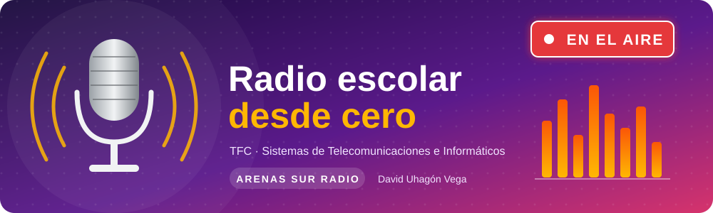
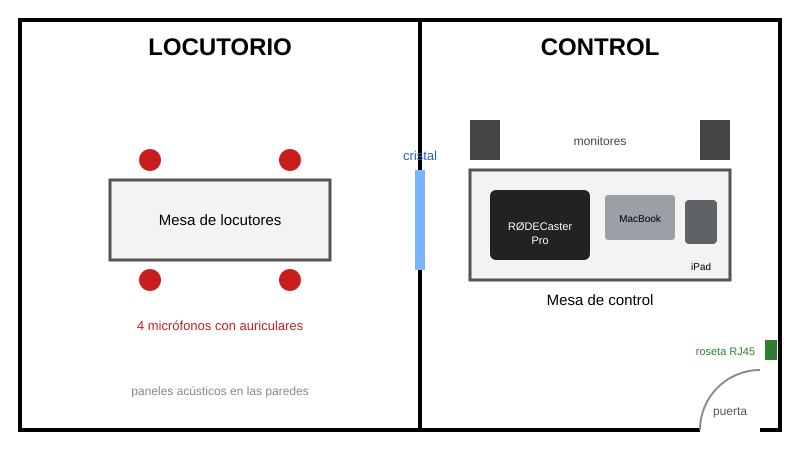
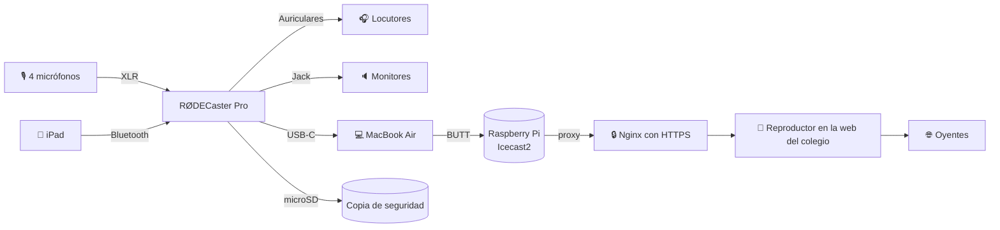
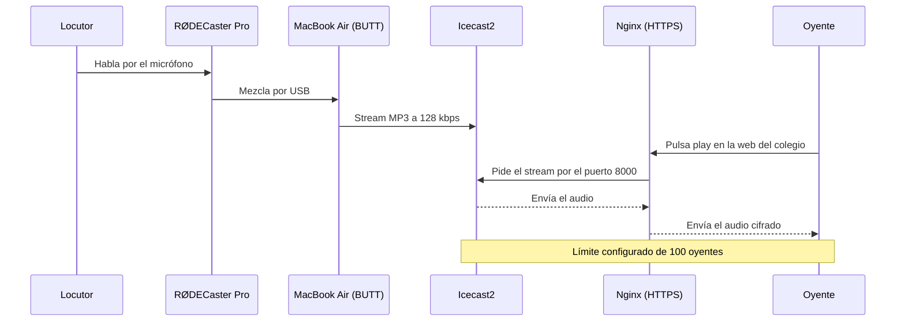
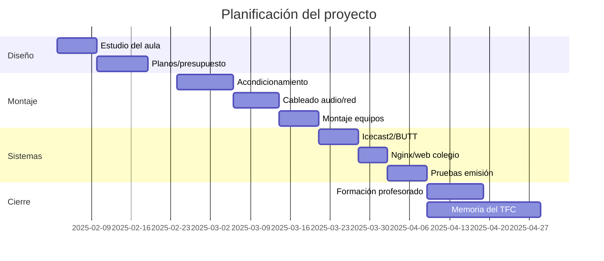
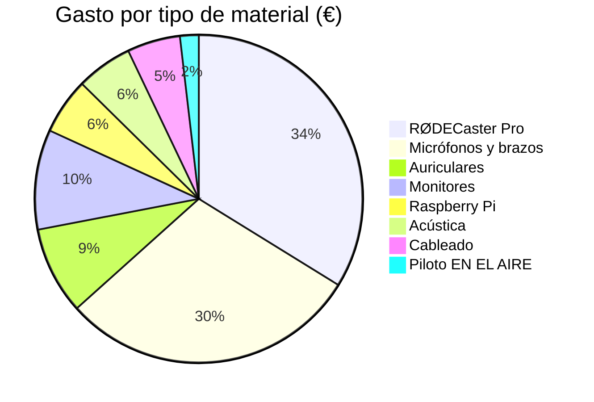
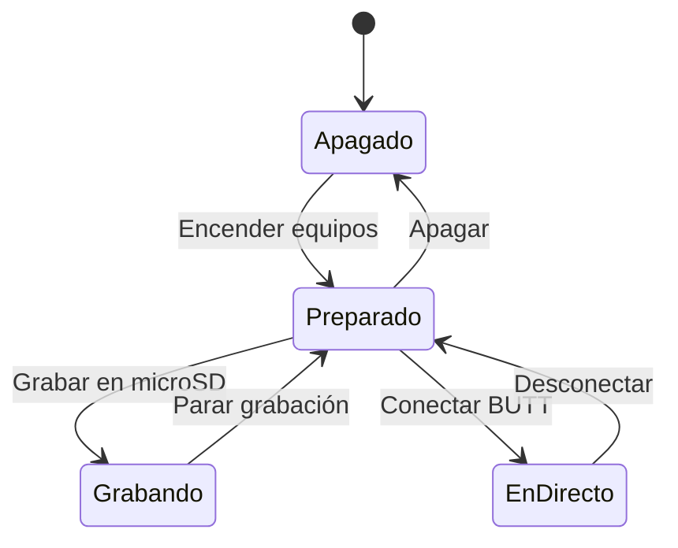
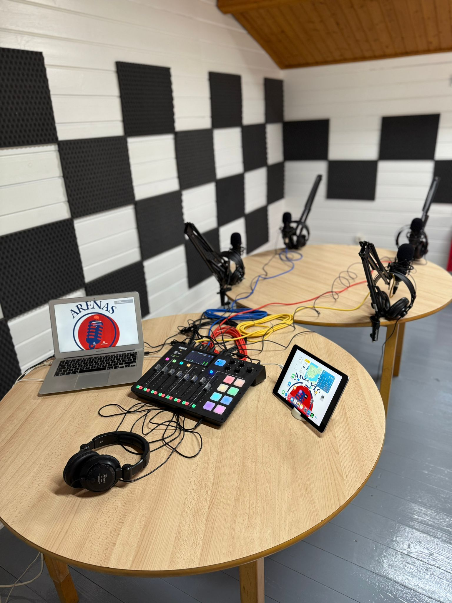
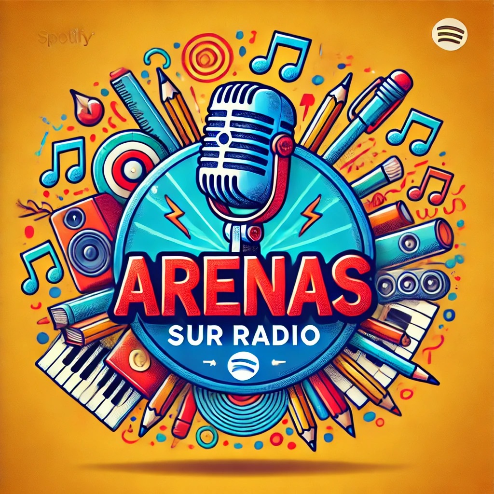

<!-- AE01.11 Markdown. Proyecto - David Uhagón Vega - 1º IABD -->
<!-- Tema: mi trabajo de fin de ciclo de Telecomunicaciones (radio escolar) -->

<div align="center">




</div>

<br>

<table align="center">
  <tr>
    <td align="center">⏱️<br><b>3 meses</b><br><sub>de trabajo</sub></td>
    <td align="center">💶<br><b>1624 €</b><br><sub>de presupuesto</sub></td>
    <td align="center">🎙️<br><b>4</b><br><sub>micrófonos</sub></td>
    <td align="center">🎧<br><b>100</b><br><sub>oyentes máx. (configurado)</sub></td>
    <td align="center">🌐<br><b>128 kbps</b><br><sub>calidad del stream</sub></td>
  </tr>
</table>

---

# Índice

| Nº | Apartado | De qué trata |
|:---:|:---|:---|
| 1 | 📖 [Introducción](#introducción "Ir a la introducción") | Punto de partida y motivo del proyecto |
| 2 | 📻 [Descripción del proyecto](#descripción-del-proyecto "Ir a la descripción") | Equipos principales y funcionamiento |
| 3 | 🎯 [Objetivos](#objetivos "Ir a los objetivos") | Qué quería conseguir y lista de tareas |
| 4 | 🧰 [Material utilizado](#material-utilizado "Ir al material") | Equipos de audio e informática |
| 5 | 🔧 [Instalación del estudio](#instalación-del-estudio "Ir a la instalación") | Distribución, cableado y acústica |
| 6 | 📡 [Configuración del streaming](#configuración-del-streaming "Ir al streaming") | Icecast2, BUTT, emisión en la web del colegio y copias |
| 7 | 💶 [Presupuesto](#presupuesto "Ir al presupuesto") | Coste del material |
| 8 | 🧮 [Cálculos del proyecto](#cálculos-del-proyecto "Ir a los cálculos") | Red, almacenamiento, niveles y acústica |
| 9 | 📅 [Planificación](#planificación "Ir a la planificación") | Fases, reparto del gasto y estados |
| 10 | ✅ [Resultado final](#resultado-final "Ir al resultado") | Cómo quedó y problemas resueltos |
| 11 | 📚 [Bibliografía y enlaces](#bibliografía-y-enlaces "Ir a la bibliografía") | Webs y archivos del proyecto |

---

# Introducción

<div align="right">

[⬆️ Volver al índice](#índice "Ir al índice")

</div>

En mi colegio ya se hacían algunos programas de radio, pero se grababan en una clase con un portátil y un micrófono USB, y el sonido se escuchaba bastante mal.  
Por eso, para el **trabajo de fin de ciclo** decidí montar un *estudio de radio completo* desde cero: desde elegir el sitio y el material hasta dejarlo emitiendo por internet.

El proyecto tiene una parte de **instalación** (cableado, acondicionamiento y montaje de equipos) y otra parte de **sistemas** (servidor de streaming, script de control y [copias de seguridad](#-copias-de-seguridad "Ir a las copias de seguridad")).<br>
Todo se hizo con un presupuesto limitado, así que hubo que buscar material que fuera ***bueno, bonito y barato***.

Al principio la idea era emitir en FM, pero eso ~~era lo más sencillo~~ no encajaba en este proyecto: hacía falta tramitar una autorización administrativa para usar una frecuencia, con unos plazos que no cabían en los meses del TFC, y comprar un transmisor y una antena que no entraban en el presupuesto. Además, el alumnado y las familias escuchan sobre todo desde el móvil, así que al final la emisión es solo por internet y en formato podcast.

> [!NOTE]
> Este documento es un resumen de la memoria del proyecto, adaptado a Markdown para la actividad AE01.11 del módulo de Programación de IA.

## 🏚️ Situación de partida

El aula elegida era un antiguo **almacén** de unos 15 m². No tenía tomas de red cerca ni ningún tipo de aislamiento, y en el recreo se oía mucho ruido del patio.

## 💡 ¿Por qué una radio escolar?

Una radio permite que el alumnado no solo escuche, sino que **participe** y cree sus propios contenidos: entrevistas, noticias del colegio, música o debates.  
Además se trabajan cosas como la expresión oral, el trabajo en equipo y el uso responsable de la tecnología.

> «La radio debe transformarse de aparato de distribución en aparato de comunicación.»
>
> — **Bertolt Brecht**, *Teoría de la radio* (1932)

---

# Descripción del proyecto

<div align="right">

[⬆️ Volver al índice](#índice "Ir al índice")

</div>

El estudio se monta alrededor de una mesa de mezclas **RØDECaster Pro** de RØDE, que está pensada para podcasts y radio. Tiene cuatro entradas de micrófono XLR, cuatro salidas de auriculares y ocho botones para lanzar sintonías y efectos, así que con un solo equipo se cubre casi todo lo que necesita un estudio pequeño.

## 🎛️ Equipos principales

### Mesa de mezclas

La RØDECaster Pro recibe los micrófonos de los locutores y la música, y hace la mezcla final. También puede grabar directamente en una tarjeta *microSD*, que sirve como copia de seguridad de cada programa.

### Ordenador

La mesa va conectada por USB a un **MacBook Air**. El Mac recibe el audio mezclado y se encarga de grabar el programa y de enviarlo al servidor de streaming.

### Música

Para poner la música se usa un **iPad** conectado a la mesa por *Bluetooth*. Así la persona que controla el programa puede elegir las canciones desde la tableta sin tocar el ordenador.

## 🔊 Funcionamiento general

El recorrido del sonido es sencillo: los micrófonos y el iPad entran en la mesa, la mesa hace la mezcla y la manda al MacBook Air, y desde el Mac se graba y se emite por internet.<br>
En los próximos apartados explicaré con más detalle el material, la instalación y la configuración del streaming.

---

# Objetivos

<div align="right">

[⬆️ Volver al índice](#índice "Ir al índice")

</div>

## 🎯 Objetivo general

Diseñar, instalar y poner en marcha un estudio de radio en el colegio que permita grabar podcasts y emitir en directo por internet.

## 📋 Objetivos específicos

1. Diseñar la distribución del estudio
   1. Separar el locutorio del control
   2. Hacer un plano con la colocación de los equipos
2. Elegir y montar el equipamiento
   - Mesa de mezclas RØDECaster Pro
   - Micrófonos y auriculares
   - MacBook Air para grabar y emitir
   - iPad para la música
3. Preparar la emisión por internet
   - Instalar el servidor de streaming
   - Conectar el MacBook Air con el servidor
4. Formar al profesorado y al alumnado en el uso del estudio

<!-- Las tareas sin marcar son mejoras que quedaron para más adelante -->

## ☑️ Lista de tareas

- [x] Elegir el aula y tomar medidas
- [x] Hacer el plano del estudio
- [x] Elegir el material y hacer el presupuesto
- [x] Acondicionar el aula (paneles y alfombra)
- [x] Cablear audio y red
- [x] Configurar el servidor de streaming
- [x] Poner el reproductor en la web del colegio
- [x] Hacer pruebas de emisión
- [x] Formar al profesorado
- [ ] Subir los programas a Spotify de forma automática
- [ ] Preparar una segunda cabina para entrevistas

---

# Material utilizado

<div align="right">

[⬆️ Volver al índice](#índice "Ir al índice")

</div>

He intentado aprovechar al máximo cada equipo para no comprar cosas que no hacían falta. Por ejemplo, como la mesa ya trae **cuatro salidas de auriculares**, no hizo falta comprar un amplificador de auriculares aparte.

## 🎙️ Equipos de audio

- **Mesa de mezclas [RØDECaster Pro](https://rode.com/es/interfaces-and-mixers/rodecaster-series/rodecaster-pro "Página oficial de la RØDECaster Pro")**
  - 4 entradas de micrófono XLR
  - 4 salidas de auriculares con volumen independiente
  - 8 pads para sintonías y efectos
  - Grabación directa en tarjeta *microSD*
- **Micrófonos dinámicos** (4 unidades)
  - Con brazo articulado para cada locutor
- **Auriculares cerrados** (4 unidades)
  - Uno por locutor, conectados a las 4 salidas de auriculares de la mesa
  - La persona del control escucha por los monitores, así que no necesita una quinta salida
- **Monitores de estudio** para escuchar en el control

## 💻 Equipos informáticos

- **MacBook Air**
  - Conectado a la mesa por USB
  - Graba el programa y lo envía al servidor de streaming
- **iPad**
  - Conectado a la mesa por *Bluetooth*
  - Se usa para poner la música
- **Raspberry Pi 4**
  - Hace de servidor de streaming con Icecast2 y Nginx (lo explicaré más adelante)

<details>
<summary>🤔 <b>¿Por qué micrófonos dinámicos y no de condensador?</b></summary>
<br>

Los micrófonos de condensador captan mucho más el ambiente de la sala. Como el aula no tiene un aislamiento profesional, con los dinámicos se cuela mucho menos ruido del patio. Además, la RØDECaster Pro tiene previos con ganancia suficiente para micrófonos dinámicos de poca salida.

</details>

El detalle de precios está en el apartado de [presupuesto](#presupuesto "Ir al presupuesto").

---

# Instalación del estudio

<div align="right">

[⬆️ Volver al índice](#índice "Ir al índice")

</div>

## 📐 Distribución

El estudio se dividió en dos zonas separadas por un cristal: el **locutorio**, donde están los locutores con los micrófonos, y el **control**, donde está la persona que lleva la mesa, el MacBook Air y el iPad.

<p align="center">
  <br>
  <sub><i>Figura 1. Plano del estudio con el locutorio a la izquierda y el control a la derecha.</i></sub>
</p>

El plano también está disponible como [archivo independiente](img/plano_estudio.svg "Abrir el plano del estudio").

## 🔊 Cadena de audio

Así va la señal desde los micrófonos hasta los oyentes:



## 🔌 Cableado

1. Audio
   - Micrófonos a la mesa con cable **XLR**
     - En los equipos, el micrófono tiene la salida XLR **macho** y la mesa la entrada XLR **hembra**
     - Por eso el cable lleva el extremo **hembra** hacia el micrófono y el **macho** hacia la mesa
     - Longitud máxima de 5 m
   - Mesa a los monitores con cable *jack* de 6,3 mm
   - Mesa al MacBook Air con cable **USB-C**
2. Red
   - Cable **UTP Cat6** desde el rack del pasillo hasta el control
   - Roseta doble RJ45: una toma para el MacBook Air y otra para la Raspberry Pi
3. Inalámbrico
   - iPad emparejado con la mesa por *Bluetooth*

> [!WARNING]
> Antes de conectar o desconectar un micrófono hay que bajar su canal y desactivar la alimentación *phantom*. Si no, se produce un golpe de sonido muy fuerte que llega a los monitores y a los auriculares y puede dañar los altavoces o molestar a quien los lleva puestos. Los micrófonos dinámicos que usamos no necesitan *phantom*, así que la dejamos siempre apagada.

## 🧽 Acondicionamiento acústico

El aula tenía mucho eco y entraba el ruido del patio. Para mejorarlo se pusieron **paneles de espuma** en las paredes del locutorio y una alfombra en el suelo.  
Para comprobar la mejora medí la reverberación con un sonómetro antes y después de colocarlos. Los resultados están en el apartado de [cálculos](#cálculos-del-proyecto "Ir a los cálculos").

## 🔗 Referencias del material

- [Guía de usuario de la RØDECaster Pro](https://rode.com/es/user-guides/rodecaster-pro "Manual oficial de RØDE")
- [Raspberry Pi 4](https://www.raspberrypi.com/products/raspberry-pi-4-model-b/ "Página oficial de la Raspberry Pi 4")
- [Logo de la radio](img/logo_arenas_sur_radio.jpeg "Ver el logo del podcast en grande")

---

# Configuración del streaming

<div align="right">

[⬆️ Volver al índice](#índice "Ir al índice")

</div>

La emisión en directo funciona así: el **MacBook Air** recibe el audio de la RØDECaster Pro por USB y lo envía con el programa `BUTT` (*Broadcast Using This Tool*) a un servidor **Icecast2** instalado en la Raspberry Pi 4. Los oyentes no entran directamente en Icecast: escuchan la radio desde un reproductor que está en la **web del colegio**, y el audio les llega por HTTPS a través de **Nginx**, que también está instalado en la Raspberry.

## 🔗 Conexiones

| Equipo | Conexión | Destino | Función |
|:---:|:---:|:---:|:---:|
| RØDECaster Pro | USB-C | MacBook Air | Envía la mezcla al ordenador |
| iPad | Bluetooth | RØDECaster Pro | Música |
| MacBook Air | Ethernet | Raspberry Pi 4 | Envía el stream con BUTT |
| Raspberry Pi 4 | Ethernet (HTTPS) | Internet | Sirve el stream a la web del colegio |

## 🏷️ Nombre de la Raspberry

Para no tener que recordar la IP, le cambié el nombre a la Raspberry:

```bash
sudo hostnamectl set-hostname radio-arenas
sudo reboot
```

Raspberry Pi OS trae instalado Avahi, así que desde el MacBook Air ya se puede llegar a ella como `radio-arenas.local`:

```bash
ping radio-arenas.local
```

## ⚙️ Instalación de Icecast2

Desde la terminal de la Raspberry Pi:

```bash
sudo apt update
sudo apt install icecast2
# durante la instalación pregunta las contraseñas
sudo systemctl enable icecast2
sudo systemctl start icecast2
systemctl status icecast2
```

Para comprobar que el servidor responde, desde la propia Raspberry:

```bash
curl -I http://localhost:8000
```

Si devuelve `HTTP/1.0 200 OK`, Icecast está funcionando. También se puede abrir `http://IP_RASPBERRY:8000` desde otro equipo de la red y debe aparecer la página de estado de Icecast.

## 📝 Configuración del servidor

Este es un **extracto** del fichero `/etc/icecast2/icecast.xml` con las partes que cambié. El resto del archivo se dejó como viene por defecto en la instalación:

```xml
<hostname>radio.colegioarenassur.com</hostname>

<limits>
    <clients>100</clients>
    <sources>2</sources>
</limits>

<authentication>
    <source-password>********</source-password>
    <admin-user>admin</admin-user>
    <admin-password>********</admin-password>
</authentication>

<listen-socket>
    <port>8000</port>
</listen-socket>
```

En `<hostname>` va el nombre por el que se escucha la radio desde fuera, para que los enlaces que genera Icecast apunten bien.

El valor `<clients>100</clients>` es un **límite**: Icecast no deja conectarse a más de 100 oyentes a la vez. No significa que se haya comprobado que el servidor aguanta esas 100 conexiones, porque no se hizo una prueba de carga. En las pruebas reales hubo como mucho unos pocos oyentes a la vez.

> [!IMPORTANT]
> Las contraseñas por defecto de Icecast son `hackme`. Hay que cambiarlas siempre, aunque el puerto 8000 no se abra al exterior: cualquiera de la red del colegio podría conectarse y emitir.

## 🌍 Emisión a través de la web del colegio

La idea era que las familias pudieran escuchar la radio desde la página web del colegio, [colegioarenassur.com](https://colegioarenassur.com "Web del Colegio Arenas Sur"), sin tener que apuntar ninguna IP ni puerto. El problema es que la web del colegio va por **HTTPS**, y los navegadores bloquean un audio que llegue por HTTP desde una página HTTPS (contenido mixto). Por eso el stream también tenía que ir por HTTPS.

La solución fue poner **Nginx** delante de Icecast en la misma Raspberry. Nginx recibe las conexiones HTTPS de fuera y se las pasa a Icecast por dentro, así que el puerto 8000 nunca se abre al exterior.

### Requisitos de red

| Requisito | Valor | Quién lo configuró |
|:---|:---:|---:|
| IP fija de la Raspberry | Reserva DHCP en el router | Yo |
| Registro DNS | `radio.colegioarenassur.com` → IP pública del colegio | Empresa de la web |
| Puertos abiertos en el router (NAT) | 80 y 443 → Raspberry | Yo |
| Puerto 8000 | Solo red interna | - |
| Subida a internet | Mínimo 13 Mbps (ver [cálculos](#cálculos-del-proyecto "Ir a los cálculos")) | - |
| Conexión de la Raspberry | Cable Ethernet, no WiFi | Yo |

El puerto 80 hace falta para que Let's Encrypt pueda comprobar el dominio al crear y renovar el certificado.

### Instalación de Nginx y del certificado

```bash
sudo apt install nginx certbot python3-certbot-nginx
sudo certbot --nginx -d radio.colegioarenassur.com
```

Certbot pide el certificado a **Let's Encrypt**, lo guarda en `/etc/letsencrypt/` y deja programada la renovación automática. Para comprobar que la renovación funciona:

```bash
sudo certbot renew --dry-run
```

### Configuración de Nginx

Fichero `/etc/nginx/sites-available/radio`:

```nginx
server {
    listen 443 ssl;
    server_name radio.colegioarenassur.com;

    ssl_certificate /etc/letsencrypt/live/radio.colegioarenassur.com/fullchain.pem;
    ssl_certificate_key /etc/letsencrypt/live/radio.colegioarenassur.com/privkey.pem;

    location /radio {
        proxy_pass http://127.0.0.1:8000/radio;
        # sin esto Nginx guarda el audio en el buffer y se corta
        proxy_buffering off;
        proxy_set_header Host $host;
        proxy_set_header X-Real-IP $remote_addr;
    }
}
```

Para activarlo:

```bash
sudo ln -s /etc/nginx/sites-available/radio /etc/nginx/sites-enabled/
sudo nginx -t
sudo systemctl reload nginx
```

### Reproductor en la web del colegio

En la página de la radio de la web del colegio se añadió este reproductor:

```html
<audio controls preload="none">
  <source src="https://radio.colegioarenassur.com/radio" type="audio/mpeg">
  Tu navegador no puede reproducir la radio.
</audio>
```

Con `preload="none"` el navegador no empieza a descargar el audio hasta que el oyente pulsa el play, así no se gastan datos solo por abrir la página.

## 📤 Configuración de BUTT en el MacBook Air

BUTT envía el audio a Icecast por la red interna, sin pasar por Nginx. Los ajustes están en **Settings** → **Main** (servidor) y **Settings** → **Audio** / **Stream**:

| Apartado | Parámetro | Valor |
|:---|:---|---:|
| Servidor | Tipo | Icecast |
| Servidor | Dirección | `radio-arenas.local` |
| Servidor | Puerto | 8000 |
| Servidor | Contraseña | La `source-password` de Icecast |
| Servidor | Punto de montaje | `/radio` |
| Audio | Dispositivo de entrada | RØDECaster Pro (USB) |
| Audio | Canales | Estéreo |
| Audio | Frecuencia de muestreo | 48 000 Hz |
| Stream | Códec | MP3 |
| Stream | Bitrate | 128 kbps |
| Stream | Reconexión automática | Activada |
| Info | Nombre de la emisora | Arenas Sur Radio |

La reconexión automática es importante: si la Raspberry se reinicia o se corta la red un momento, BUTT vuelve a conectarse solo y el programa sigue.

Con estos ajustes, el MP3 reduce mucho el audio que sale de la mesa. Si el sonido sin comprimir es de 16 bits y estéreo, el factor de compresión es $r = \frac{48\,000 \cdot 16 \cdot 2}{128\,000} = 12$, es decir, el stream ocupa 12 veces menos.

> [!TIP]
> Para comprobar el stream sin altavoces se puede abrir `http://radio-arenas.local:8000/radio` en un móvil conectado a la red del colegio, y `https://radio.colegioarenassur.com/radio` con los datos móviles para probarlo desde fuera. Para cerrar BUTT en el Mac sirve <kbd>Cmd</kbd> + <kbd>Q</kbd>, el atajo general de macOS para salir de una aplicación.

## 🔴 Emisión en directo paso a paso



## 🐍 Script de comprobación

Hice un pequeño script en Python que mira cada 5 minutos si la radio está emitiendo y lo apunta en un log. El script completo está en [scripts/comprobar_stream.py](scripts/comprobar_stream.py "Ver el script"). Este es el trozo principal, con los tres casos posibles:

```python
try:
    respuesta = urllib.request.urlopen(URL_ESTADO, timeout=5)
    datos = json.loads(respuesta.read().decode("utf-8"))
except Exception as e:
    # caso 1: Icecast no responde
    escribir_log("ERROR: no se puede conectar con Icecast (" + str(e) + ")")
    return False

fuentes = datos["icestats"].get("source", [])
if isinstance(fuentes, dict):
    fuentes = [fuentes]

for fuente in fuentes:
    if fuente.get("listenurl", "").endswith(PUNTO_MONTAJE):
        # caso 2: se está emitiendo
        escribir_log("OK: emitiendo con " + str(fuente.get("listeners", 0)) + " oyentes")
        return True

# caso 3: Icecast funciona pero nadie emite
escribir_log("AVISO: Icecast funciona pero no hay nadie emitiendo en " + PUNTO_MONTAJE)
return False
```

En la Raspberry el script está guardado en `/home/pi/scripts/comprobar_stream.py` y el log se crea en la misma carpeta (`/home/pi/scripts/log_stream.txt`). Para que se ejecute solo, se añade esta línea con `crontab -e`:

```bash
*/5 * * * * python3 /home/pi/scripts/comprobar_stream.py
```

Antes de dejarlo en cron hay que comprobar que la ruta es la correcta:

```bash
ls -l /home/pi/scripts/comprobar_stream.py
python3 /home/pi/scripts/comprobar_stream.py && tail -n 1 /home/pi/scripts/log_stream.txt
```

## 💾 Copias de seguridad

Cada programa se guarda en dos sitios a la vez y después se copia fuera del estudio:

1. Durante el programa
   - La RØDECaster Pro graba en la tarjeta *microSD*
   - El MacBook Air graba la misma mezcla que llega por USB
2. Al terminar cada programa
   - Se copia el archivo WAV de la microSD a una carpeta del MacBook Air con la fecha del programa
   - Desde el Mac se sube a la unidad compartida del colegio en la nube
3. Limpieza
   - La microSD solo se borra cuando se ha comprobado que el archivo está en la nube y se reproduce bien

Para **recuperar** un programa basta con descargarlo de la unidad compartida. La configuración de Icecast y la de Nginx también tienen copia en la Raspberry, por si hay que reinstalar:

```bash
sudo cp /etc/icecast2/icecast.xml /home/pi/backup/icecast.xml.bak
sudo cp /etc/nginx/sites-available/radio /home/pi/backup/nginx_radio.bak
```

---

# Presupuesto

<div align="right">

[⬆️ Volver al índice](#índice "Ir al índice")

</div>

El MacBook Air y el iPad ya los tenía el colegio, así que no entran en el presupuesto. Los precios son aproximados y con IGIC incluido. El desglose también está en [docs/presupuesto.md](docs/presupuesto.md "Ver el presupuesto en un archivo aparte").

| Material | Unidades | Precio unidad (€) | Total (€) |
|:---|:---:|---:|---:|
| RØDECaster Pro | 1 | 549 | 549 |
| Micrófono dinámico | 4 | 95 | 380 |
| Brazo articulado | 4 | 25 | 100 |
| Auriculares cerrados | 4 | 35 | 140 |
| Monitores de estudio (pareja) | 1 | 160 | 160 |
| Raspberry Pi 4 con caja y fuente | 1 | 90 | 90 |
| Cableado XLR, jack, USB y red | - | - | 85 |
| Paneles acústicos (pack de 24) | 2 | 45 | 90 |
| Piloto «EN EL AIRE» | 1 | 30 | 30 |
| **TOTAL** | | | **1624** |

El total es la suma de la última columna:

$$
T = \sum_{i=1}^{9} T_i = 549 + 380 + 100 + 140 + 160 + 90 + 85 + 90 + 30 = 1624\ \text{€}
$$

<p align="center">
  <sub>💶 Lo más caro fue la mesa, pero sustituye a la vez a la mesa de mezclas, la grabadora y el amplificador de auriculares.</sub>
</p>

> «El medio es el mensaje.»
>
> — **Marshall McLuhan**, *Comprender los medios de comunicación* (1964)

---

# Cálculos del proyecto

<div align="right">

[⬆️ Volver al índice](#índice "Ir al índice")

</div>

## 📶 Ancho de banda del stream

El ancho de banda de subida que necesita el servidor depende del bitrate $b$ y del número de oyentes $N$:

$$
BW = N \cdot b = 100 \cdot 128\ \text{kbps} = 12\,800\ \text{kbps} \approx 12{,}8\ \text{Mbps}
$$

Este valor es solo el audio. A eso hay que sumar la sobrecarga de los protocolos (TCP/IP y HTTP), así que el consumo real es algo mayor. Aun así, la fibra del colegio tiene bastante más subida. Es un cálculo para el límite configurado de 100 oyentes, no una capacidad comprobada con una prueba de carga.

## 〰️ Muestreo del audio

Según el teorema de Nyquist, la frecuencia de muestreo tiene que ser al menos el doble de la frecuencia máxima: $f_s \geq 2 \cdot f_{max}$. Con $f_{max} = 20\ \text{kHz}$, que es el límite del oído, sale $f_s \geq 40\ \text{kHz}$. La RØDECaster Pro trabaja a $48\ \text{kHz}$, así que se cumple de sobra.

## 💾 Espacio de las grabaciones

La mesa graba en la microSD en WAV a 48 kHz, 24 bits y estéreo. Un programa de 30 minutos ocupa:

$$
T = f_s \cdot n \cdot c \cdot t = 48\,000 \cdot 24 \cdot 2 \cdot 1800 \approx 4{,}15 \cdot 10^{9}\ \text{bits} \approx 518\ \text{MB}
$$

En MP3 a 128 kbps el mismo programa ocupa $128\,000 \cdot 1800 / 8 \approx 28{,}8\ \text{MB}$, por eso los podcasts se publican en MP3.

## 📲 Datos que consume un oyente

Muchas familias escuchan la radio desde el móvil con datos, así que calculé cuánto gasta una hora de emisión a $b = 128\ \text{kbps}$:

$$
D = \frac{b \cdot t}{8} = \frac{128\,000 \cdot 3600}{8} = 57\,600\,000\ \text{bytes} \approx 57{,}6\ \text{MB}
$$

Un programa de 30 minutos gasta la mitad, unos $28{,}8\ \text{MB}$.

## 🗂️ Capacidad de la tarjeta microSD

Con una tarjeta de $64\ \text{GB}$ y grabando en WAV, una hora ocupa el doble que el programa de 30 minutos, unos $1{,}04\ \text{GB}$. Las horas que caben son:

$$
h = \frac{C}{T_{1h}} = \frac{64\ \text{GB}}{1{,}04\ \text{GB/h}} \approx 61\ \text{h}
$$

Como se graba un programa a la semana, la tarjeta da para muchos meses, pero se vacía después de cada copia de seguridad.

## 🎛️ Niveles de audio

Para ajustar la ganancia de los micrófonos en la mesa se trabaja en decibelios:

$$
G_{dB} = 20 \cdot \log_{10}\left(\frac{V_{salida}}{V_{entrada}}\right)
$$

Por ejemplo, si la mesa sube la señal de un micrófono de $2\ \text{mV}$ a $1\ \text{V}$, la ganancia es $20 \cdot \log_{10}(1 / 0{,}002) \approx 54\ \text{dB}$.

## 📏 Distancia al micrófono

El nivel del sonido baja con la distancia según la ley inversa del cuadrado:

$$
\Delta L = 20 \cdot \log_{10}\left(\frac{d_2}{d_1}\right)
$$

Si un locutor se aleja de $10\ \text{cm}$ a $20\ \text{cm}$ del micrófono, el nivel baja $20 \cdot \log_{10}(2) \approx 6\ \text{dB}$. Por eso en la formación se insistió en hablar siempre a la misma distancia, a un palmo del micrófono.

## ➕ Suma de dos fuentes de sonido

Los decibelios no se suman directamente. Para dos fuentes de nivel $L_1$ y $L_2$:

$$
L_{total} = 10 \cdot \log_{10}\left(10^{L_1/10} + 10^{L_2/10}\right)
$$

Si dos locutores hablan a la vez a $70\ \text{dB}$ cada uno, el total no es $140\ \text{dB}$ sino $70 + 10 \cdot \log_{10}(2) \approx 73\ \text{dB}$.

## 🔁 Reverberación del locutorio

Con la fórmula de Sabine se calcula el tiempo de reverberación $T_{60}$ a partir del volumen $V$ de la sala y de la absorción total $A$:

$$
T_{60} = 0{,}161 \cdot \frac{V}{A}
$$

Medí el tiempo de reverberación con un sonómetro con función RT60, antes y después de poner los paneles y la alfombra. La fuente de sonido fue el estallido de un globo en el centro del locutorio. Hice tres medidas en cada caso y en la tabla está la media:

| Frecuencia (Hz) | RT60 antes (s) | RT60 después (s) |
|:---:|:---:|:---:|
| 250 | 1,9 | 0,78 |
| 500 | 1,7 | 0,60 |
| 1000 | 1,6 | 0,52 |
| 2000 | 1,5 | 0,45 |

Para comprobar que las medidas tenían sentido, las comparé con la fórmula de Sabine. El locutorio mide $3 \times 2{,}5\ \text{m}$ con $2{,}7\ \text{m}$ de alto, es decir, $V = 20{,}25\ \text{m}^3$. Los coeficientes de absorción son valores de tablas a 1000 Hz.

| Superficie | Área (m²) | α antes | α después |
|:---|:---:|:---:|:---:|
| Suelo de terrazo | 7,5 | 0,02 | 0,02 (3,5 m²) |
| Alfombra | 4 | - | 0,30 |
| Techo de escayola | 7,5 | 0,05 | 0,05 |
| Paredes enlucidas | 28,7 | 0,03 | 0,03 (24,38 m²) |
| Paneles de espuma (48 de 30 × 30 cm) | 4,32 | - | 0,70 |
| Cristal | 1 | 0,03 | 0,03 |
| Mobiliario (mesa y sillas) | - | 0,5 m² equivalentes | 0,5 m² equivalentes |

La absorción total es $A = \sum S_i \cdot \alpha_i$:

- Antes: $A \approx 1{,}92\ \text{m}^2$, así que $T_{60} = 0{,}161 \cdot 20{,}25 / 1{,}92 \approx 1{,}7\ \text{s}$
- Después: $A \approx 5{,}93\ \text{m}^2$, así que $T_{60} = 0{,}161 \cdot 20{,}25 / 5{,}93 \approx 0{,}55\ \text{s}$

El cálculo a 1000 Hz (1,7 s y 0,55 s) sale muy parecido a lo medido (1,6 s y 0,52 s), así que las medidas son coherentes. La reverberación bajó a un tercio. Para una sala de locución se suele buscar entre 0,3 y 0,5 s, así que todavía se podría mejorar con algunos paneles más, sobre todo para las frecuencias graves.

---

# Planificación

<div align="right">

[⬆️ Volver al índice](#índice "Ir al índice")

</div>

## 🗓️ Diagrama de Gantt



## 💶 Reparto del presupuesto



## 🔄 Estados del estudio



---

# Resultado final

<div align="right">

[⬆️ Volver al índice](#índice "Ir al índice")

</div>

<p align="center">
  <br>
  <sub><i>Figura 2. El estudio terminado: el control con la RØDECaster Pro, el MacBook Air y el iPad, y detrás la mesa de locutores con los cuatro micrófonos.</i></sub>
</p>

> [!NOTE]
> En la foto todavía no está el cristal que separa el control del locutorio, porque cuando se hizo no habían llegado los materiales para montar la separación. Se instaló después, como aparece en el [plano del estudio](#-distribución "Ver el plano").

El estudio quedó funcionando y el alumnado graba programas casi todas las semanas. Los programas se publican como podcast en Spotify con el nombre de **Arenas Sur Radio** 🎧.

Lo que más me ha servido del ciclo para este proyecto:

* Los módulos de **instalaciones** para el cableado.
* Los de **sistemas y redes** para la Raspberry Pi y el streaming.
* Saber leer las hojas de características de los equipos 📄.

## 🛠️ Problemas que tuve

1. Zumbido en los monitores
   - Era un **bucle de masa**. Se arregló enchufando todo a la misma regleta.
2. Cortes en el stream
   - La Raspberry Pi estaba por WiFi. Al pasarla a cable se acabaron los cortes.
3. El iPad se desconectaba de la mesa
   - Había interferencias con otros dispositivos Bluetooth del aula. Se solucionó olvidando el resto de emparejamientos en el iPad.
4. El reproductor de la web del colegio no sonaba
   - El navegador bloqueaba el audio por llegar por HTTP desde una página HTTPS. Se solucionó con Nginx y el certificado de Let's Encrypt.
5. Eco en el locutorio
   - Se solucionó con los paneles y la alfombra.

---

# Bibliografía y enlaces

<div align="right">

[⬆️ Volver al índice](#índice "Ir al índice")

</div>

- [Página oficial de la RØDECaster Pro](https://rode.com/es/interfaces-and-mixers/rodecaster-series/rodecaster-pro "RØDE")
- [Documentación de Icecast](https://icecast.org/docs/ "Web oficial de Icecast")
- [BUTT - Broadcast Using This Tool](https://danielnoethen.de/butt/ "Programa para emitir")
- [Raspberry Pi OS](https://www.raspberrypi.com/software/ "Sistema operativo de la Raspberry Pi")
- [Documentación de Nginx](https://nginx.org/en/docs/ "Web oficial de Nginx")
- [Let's Encrypt](https://letsencrypt.org/es/getting-started/ "Certificados HTTPS gratuitos")
- [Certbot](https://certbot.eff.org/ "Programa para pedir los certificados")
- [Escribir y dar formato en GitHub](https://docs.github.com/es/get-started/writing-on-github/getting-started-with-writing-and-formatting-on-github/basic-writing-and-formatting-syntax "Documentación de GitHub")
- [Diagramas Mermaid](https://mermaid.js.org/ "Documentación de Mermaid")

Archivos del proyecto:

- [Presupuesto detallado](docs/presupuesto.md "Presupuesto")
- [Script de comprobación del stream](scripts/comprobar_stream.py "Script en Python")
- [Plano del estudio](img/plano_estudio.svg "Plano")

<div align="center">

<br>
<sub><i>Logo del podcast Arenas Sur Radio en Spotify</i></sub>


<sub>Proyecto realizado en el CFGS Sistemas de Telecomunicaciones e Informáticos · 2026</sub><br>
🎙️ 📻 🎧 🎚️ 🔊

</div>

<!-- Fin del documento -->
